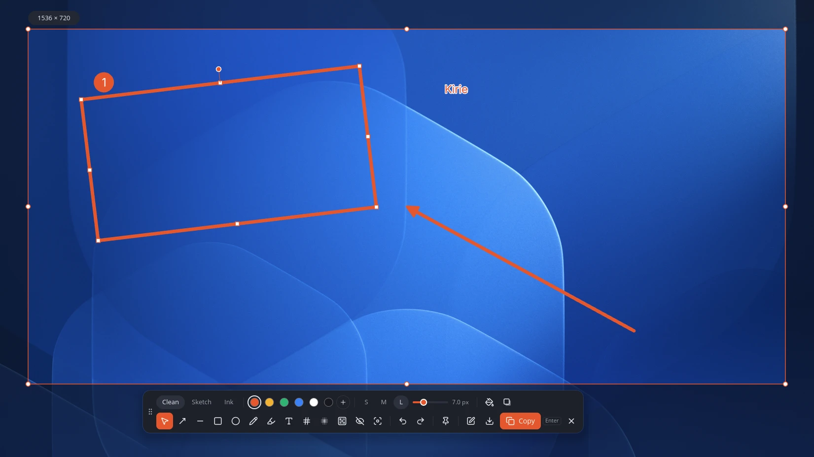
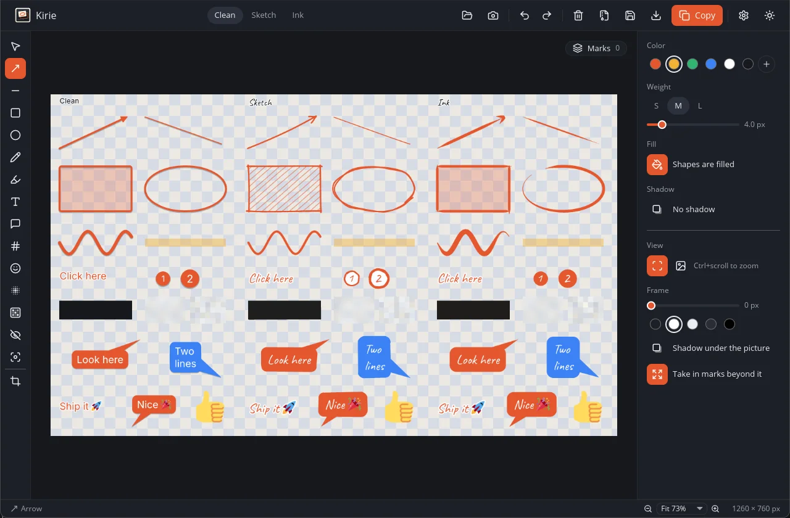

<h1 align="center">Kirie</h1>

<p align="center">
  
</p>

<p align="center">
  <a href="https://github.com/samuelba/kirie/actions/workflows/ci.yml"></a>
  <a href="https://github.com/samuelba/kirie/releases/latest"></a>
  <a href="LICENSE"></a>
</p>

Kirie (切り絵, Japanese paper-cut art) is a screenshot and annotation tool for Wayland. Cut a
piece out of your screen, mark it up right there or later in the editor, and copy or save it.

It runs on GNOME, COSMIC, KDE Plasma and the layer-shell compositors (sway, Hyprland, niri,
Wayfire). X11 is not supported. More at [samuelba.dev/kirie](https://samuelba.dev/kirie).





## Install

```sh
curl -fsSL https://samuelba.dev/kirie/install.sh | sh
```

The script installs Kirie for your user, without sudo, to `~/.local/bin/kirie`, with its desktop
entry and icons. Run it again to update. Uninstall with:

```sh
curl -fsSL https://samuelba.dev/kirie/install.sh | sh -s -- --uninstall
```

When `minisign` or `rsign` is installed, the script checks the release's signature before
installing anything.

## Set up a shortcut

```sh
kirie shortcuts install
```

This binds **Shift+Print** to `kirie capture`, so your desktop's own screenshot tool keeps Print.

| Desktop | How Kirie captures and shows the overlay |
|---|---|
| **GNOME** | Install the companion extension with `kirie gnome-extension install` and log out once. It brings the shortcut, takes screenshots without a permission dialog, and keeps the overlay above every window. Without it, Kirie uses the screenshot portal (GNOME asks for permission once) and a fullscreen window, which shows one screen only: GNOME does not let an app pick the screen for a window. Ctrl+A still takes every screen. |
| **COSMIC** | `ext-image-copy-capture` and a layer-shell overlay on every screen. `kirie shortcuts install` adds the shortcut to COSMIC's keyboard settings. |
| **KDE Plasma** | The screenshot portal and a layer-shell overlay. Add the shortcut in System Settings; `kirie shortcuts install` tells you how. |
| **sway, Hyprland, niri, Wayfire** | `wlr-screencopy` or `ext-image-copy-capture` and a layer-shell overlay. Bind `kirie capture` in your compositor's config; `kirie shortcuts install` prints an example. |

## Use it

`kirie capture` freezes every screen. Drag to cut out a region, or click to take the window
under the pointer (on GNOME with the extension, COSMIC, sway and Hyprland). **Take this screen**
in the hint at the bottom takes the whole screen; where Kirie cannot see windows, a click does.
A loupe beside the pointer shows the pixels around it, magnified, with
its position and color, so edges land on the exact pixel. Then mark it up with the toolbar under
the selection.

| Key | Does |
|---|---|
| Enter or Ctrl+C | Copy the picture and close |
| Ctrl+S, Shift+Enter or Ctrl+Enter | Save it to `~/Pictures/Screenshots` (or the folder in the settings), copy it too, and close |
| Ctrl+Shift+S | Save it where you choose, as PNG, JPEG, WebP or a `.kirie` project |
| Ctrl+E | Open it in the editor, with its marks still editable |
| Ctrl+A | Select every screen |
| Arrow keys | Move the selection (with Shift: by 10) |
| Ctrl+Z, Ctrl+Shift+Z | Undo, redo |
| Esc | Put the tool down, then cancel |
| V A L R E P H T N B X D S | Select, Arrow, Line, Rectangle, Ellipse, Pen, Highlighter, Text, Step number, Blur, Pixelate, Redact, Spotlight |

Hold **Shift** while drawing to snap lines to 45° and boxes to squares.

With the select tool, drag a box around marks to pick them all, or Shift+click a mark to add it
or take it out. Picked marks move, change color and delete together; in the editor, Ctrl+A picks
every mark. Ctrl+D duplicates the picked marks. Ctrl+Shift+] brings them to the front and Ctrl+Shift+[
sends them to the back (Ctrl+] and Ctrl+[ move them one place); the editor has buttons for both. In the editor, Ctrl+C and Ctrl+X copy or cut
them (with nothing picked, Ctrl+C copies the picture), and Ctrl+V pastes them back where they
were, or onto another image. With an image open, Ctrl+V puts a copied picture on top of it as
a mark of its own, to move and resize: its corners keep its proportions, unless you hold Shift.

To catch an open menu, a tooltip or a hover state, wait before the screenshot:
`kirie capture --delay 5` takes it after five seconds (up to 60).

Kirie puts an icon in the tray once you open it or take a screenshot, on KDE Plasma, COSMIC and
GNOME with the AppIndicator extension (Ubuntu has it). Its menu opens Kirie, takes a screenshot
now or in 3 or 10 seconds, shows what Kirie is, and quits the icon.

Taking the same region again and again? Press the pin in the toolbar: the next screenshot starts
with that region selected, so Enter takes it at once. Moving or resizing the selection unpins it.

Right-click a color, or press +, to open the color picker. Its lowest strip sets how opaque
the color is, for marks you can see through. Its pipette takes a color from the screenshot: a loupe follows the pointer with the color under it, and a click takes it (Esc
puts the pipette down).

**Settings** (the gear in the editor's header, Ctrl+, or the tray menu) choose the folder
screenshots are saved to, their file name (with `%Y`, `%m`, `%d`, `%H`, `%M` and `%S` for the
time they were taken), and whether saving copies them too. They live in
`~/.config/kirie/settings.ron`.

Kirie keeps the style, color, weight, text look, shadow, spotlight brightness and frame you last
used for the next screenshot, in `~/.local/state/kirie/drawing.ron`.

`kirie` opens the editor. Paste an image into the empty editor with Ctrl+V, open one with `kirie edit FILE`, or take a
screenshot from its header. The bin in the header (Ctrl+W) discards the image; Ctrl+Q closes
the editor. Both ask first when there are unsaved changes. Zoom with Ctrl+scroll, Ctrl+plus and Ctrl+minus, or the zoom control
in the status bar (Ctrl+0 fits the image, Ctrl+1 shows it at actual size); pan with the scroll
wheel or the middle button. Press C, or the crop button under the tools, to keep only part of the image: drag the
frame and press Enter. **Frame** puts room around the picture, filled with a color or left
transparent, with a soft shadow under the picture if you like, and can take in marks drawn
beyond the picture's edges. **Save project** (Ctrl+Alt+S) keeps a `.kirie` file in `~/Pictures/Screenshots` whose marks you
can change later; **Save as** (Ctrl+Shift+S) asks where to save, as an image or a project. The installer
registers the `.kirie` file type, so a double click opens a project in Kirie.

Saved and copied images hold only the finished picture. Redact covers every pixel it touches
with solid color. Blur and pixelate scramble each block a little, so guesses of what was there
never match exactly, but they keep a trace of light and dark: use Redact for passwords, keys and
anything else that must stay secret. A `.kirie` project keeps the original screenshot, under
every mark, so that the marks stay editable; share the saved image, not the project.

### Styles

- **Clean**: crisp lines with a soft shadow.
- **Sketch**: hand-drawn lines, hatched fills and handwritten text.
- **Ink**: brush strokes that swell and taper, and an open ensō for circles.

Each style has its own shades of the standard colors: bright pastels for Sketch, the pigments of
ink painting for Ink.
Switching styles moves marks in a standard color to the new style's shade and leaves your own
colors as they are.

## Build from source

Kirie needs Rust (stable) and the Wayland and xkbcommon development files.

```sh
sudo dnf install wayland-devel libxkbcommon-devel     # Fedora
sudo apt install libwayland-dev libxkbcommon-dev      # Debian, Ubuntu

cargo build --release
cargo fmt --all --check && cargo clippy --workspace --all-targets && cargo test --workspace
```

| Crate | What it does |
|---|---|
| `kirie-capture` | Captures every screen through the compositor's protocol, Kirie's GNOME Shell extension or the screenshot portal |
| `kirie-annotate` | Documents of marks, the drawing tools, the three styles, rendering and `.kirie` projects |
| `kirie-ui` | Kirie's colors, spacing, icons and controls |
| `kirie` | The command, the on-screen overlay and the editor |

Smoke tests run Kirie under a headless compositor: `scripts/sway-smoke.sh` (needs sway) and
`scripts/gnome-smoke.sh` (needs gnome-shell, runs an isolated session with the extension).

For screenshots of Kirie itself, `KIRIE_OVERLAY_DEMO=1 kirie capture` opens the overlay with a
selection and a few marks, and `KIRIE_EDITOR_DEMO=1 kirie edit picture.png` puts one of each mark
on every image the editor opens (close a running editor first, or the image goes to that one).

## License

MIT. The GNOME Shell extension in `gnome-extension/` is GPL-2.0-or-later. The bundled fonts
(Inter, Caveat, Source Code Pro) are under the SIL Open Font License, and the icons come from
[Lucide](https://lucide.dev) under the ISC license; their licenses are in `assets/`.
